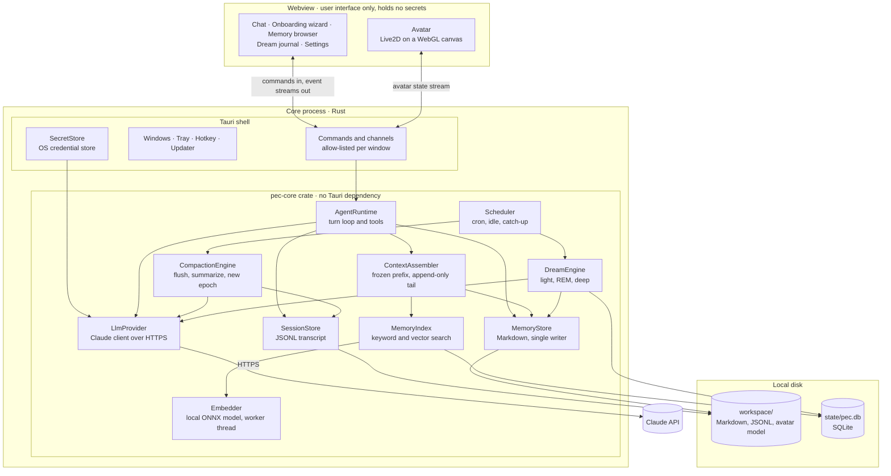
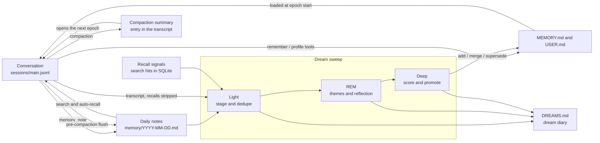

# My Pec — Architecture

**Status:** Draft v0.3 for review · **Date:** 2026-11-14 · **Companion document:** [requirements.md](requirements.md)

This document reflects the decisions recorded in [requirements.md](requirements.md) section 9: Claude as the only provider in v1, Tauri 2 as the desktop shell with the core written in Rust, a Live2D avatar, Windows first.

## 1. Principles

These seven rules drive the design. They are ratified, with their enforceable form, in [principles.md](principles.md). Each feature's requirements, decisions, data and interfaces are in [features/](features/).

1. **Files are the mind.** The soul, the profile, the memories, the transcript and the world the companion draws are plain files in one folder. The database only holds things that can be rebuilt from those files, plus bookkeeping.
2. **Local-first, and the key stays in the core process.** The user enters the key in the webview, which hands it to the core once and keeps no copy. The only conversation data that leaves the machine goes to the LLM API.
3. **The conversation is append-only between compactions.** The system prompt and tool list are frozen, and each request is the previous request plus new messages.
4. **Nothing becomes durable without provenance and an undo.** Every long-term memory points to its source, and every automatic rewrite keeps the previous version.
5. **Chat comes first.** Background work (indexing, compaction, dreaming) yields to an incoming message.
6. **The core does not know about the desktop shell.** Agent, memory, compaction and dreaming are a plain Rust crate with no Tauri dependency, and it runs headless under test.
7. **Every setting is optional.** The defaults must produce a working companion.

## 2. Technology choices

| Concern | Choice | Reason | Alternative considered |
|---|---|---|---|
| Desktop shell | Tauri 2 | An installer in the tens of megabytes and low memory use, because it uses the system webview (WebView2, preinstalled on Windows 11). The webview can be closed entirely while the core keeps running in the tray. | Electron: one language and the official Claude SDK, at several times the size. |
| Core language | Rust, in the same process as the shell | It is Tauri's native backend language, so there is no second runtime to ship. | A bundled Node sidecar running a TypeScript core with the official Claude SDK. It keeps the SDK but adds a runtime to the installer and a second IPC hop, which gives back most of what Tauri saves. |
| UI | React, TypeScript and Vite, in the webview | Common, well supported by tooling, and the Live2D SDK is TypeScript. | Svelte, Solid |
| LLM access | A hand-written Claude client in Rust: HTTPS with `reqwest`, server-sent events for streaming | There is no official Claude SDK for Rust. The Messages API is one endpoint, so the client is small, but the project owns it. | Unofficial Rust SDK crates, which lag the API. |
| Conversation and memory storage | Markdown files and JSONL transcripts | Human-readable, editable, diffable, compatible with OpenClaw's layout. | Everything in SQLite |
| Index and bookkeeping | SQLite through `rusqlite`, with FTS5 for keyword search and vectors in a plain table, scanned in memory by dot product | One embedded file, no server, no extension. A brute-force scan of tens of thousands of 384-dimensional vectors takes milliseconds (feature 008 research R3). | The `sqlite-vec` extension (revisit beyond 100,000 chunks); LanceDB |
| Embeddings | `multilingual-e5-small` (int8 ONNX, about 135 MB) run locally on a blocking worker with `ort` and `tokenizers`, downloaded from Hugging Face once the user accepts the offer, verified against a SHA-256 shipped with the app | No second API key, and Claude's API has no embeddings endpoint. Keyword search works without it. Consent keeps the new destination off until the user turns it on (Principle II). | A hosted embeddings API (needs another key); `fastembed` (its own downloader bypasses consent and verification) |
| Secrets | The OS credential store through `keyring-core` and a platform store crate (Windows Credential Manager, macOS Keychain), with persistence set to this machine only | The key is protected by the OS for the current user and is not in any app file. | A plaintext config file (rejected) |
| Scheduling | Timers on the async runtime with a cron parser, the OS last-input time for idle detection, and a wall-clock jump check to notice resume from sleep | No OS-level scheduled task to install or clean up. | Windows Task Scheduler |
| Avatar | Live2D through the official Cubism SDK for Web (Cubism 5), drawn on a WebGL canvas in the webview | The official SDK follows new Cubism versions and its licensing is clear. | Community wrappers built on PIXI: a simpler API, uneven maintenance. |
| Types across the boundary | Rust types are the single definition, and TypeScript types are generated from them with `ts-rs` | The webview and the core cannot drift apart. | `tauri-specta`, which also generates the command wrappers but has no stable release for Tauri 2 yet |
| Shell features | Tauri plugins for single instance, autostart, updater and global shortcut | Maintained with Tauri itself. | — |
| Tests | `cargo test` for the core against a fake LLM, with snapshot tests for request assembly. Vitest for the UI. End-to-end runs with WebdriverIO and `@wdio/tauri-service` on Windows, against a local server replaying recorded responses. | The core is testable without Tauri or a window. | — |

## 3. System overview



| Process | Runs | Rule |
|---|---|---|
| Core (Rust) | The Tauri shell, the command handlers, the SecretStore and the `pec-core` crate. SQLite and the embedding model run on worker threads so replies keep streaming smoothly. | The only process with the API key and the only one that talks to the Claude API. |
| Webview | All user interface, including the avatar | It reaches the core only through the commands its window's capability file allows. Strict content security policy, no remote content. It reads avatar model files only through the core's `avatar_file` command, which confines them to `workspace/avatar/` and the bundled characters. |

The core does not need a window. When the user closes to the tray, the main window is hidden and its webview stops drawing; the floating avatar, when on, keeps running. Dreaming, indexing and the scheduler carry on.

There are two windows, each with its own capability file. The main window gets the full command set. The floating avatar window gets only the avatar state event, the avatar's manifest and files, window dragging and an "open chat" command.

## 4. Data on disk

### 4.1 Workspace: the files that are the companion

Default location: `%APPDATA%\My Pec\workspace\` on Windows. The user can move it.

```
workspace/
  IDENTITY.md              name, pronouns, avatar reference, id, birth date
  SOUL.md                  personality, voice, values, boundaries
  USER.md                  stable facts and preferences about the user (replaced in place)
  MEMORY.md                curated long-term memory (bounded)
  DREAMS.md                dream diary and deep-phase summaries (for the user to read)
  memory/
    2026-11-13.md          daily notes, append-only
    dreaming/<phase>/      optional per-phase reports
  sessions/
    main.jsonl             full transcript, append-only
  avatar/
    manifest.json          version 2: live2d, static or picture, and how moods and activities map onto the model
    <character>/           the Live2D model copied from the app: .model3.json, .moc3, textures, motions, expressions
    picture.png            the user's own picture, when chosen (PNG, JPEG or WebP)
  world/
    world.jsonl            everything the companion has drawn, one item per line, append-only
    journey.jsonl          the day's topics and why each object was picked, one day per line
  notes/
    packing-list-k7q2mx.md one sticky note: its text only
    deleted/              notes the user deleted, never emptied by the app
  alarms.md                every alarm, one per line
  weather.md               the place whose weather is shown, and the units
```

The names and roles of `SOUL.md`, `IDENTITY.md`, `USER.md`, `MEMORY.md`, `DREAMS.md` and `memory/YYYY-MM-DD.md` match OpenClaw's, so an OpenClaw workspace can be imported and a My Pec workspace stays readable by other tools.

`notes/`, `alarms.md` and `weather.md` belong to the bundled extensions (requirements section 6.13, section 19 below). Window places, colours, ring history and the last weather are bookkeeping in `state/notes.json`, `state/alarms.json` and `state/weather.json`, safe to lose.

`world/` is My Pec's own, with no OpenClaw counterpart (requirements section 6.12). It lives inside the workspace, so moving, backing up, exporting or wiping the workspace includes it. The first line of `world.jsonl` names the companion it belongs to (`{"world":1,"companion":"K7Q2-M9TX-3HPA","born":"2026-11-14"}`) and is never changed; every other line is one drawn item: `{"item":"flower.daisy","x":3,"y":-2,"size":0.9,"flip":false,"shade":1,"day":"2026-11-14","why":"ambient"}`, on a grid with the home at `0,0` and one item per cell, about 110 bytes a line. The dictionary ships with the app (`crates/pec-core/src/world/items.json`, read by the core and the webview) and is not in the workspace; a line refers to an item by its permanent id. The companion's id and birth date are the `- Id:` and `- Born:` lines of `IDENTITY.md`; the id seeds its colours, the lay of its land and its preferences, which are worked out when needed and never stored. What was drawn is stored, so the file alone is enough to show the world, and an update to the app or its dictionary never changes it. Growth is a pure function of the id, the local date and the world so far, run after the first message the user sends on a day; `state.json` keeps the last drawn day (`world.lastDay`) so a day never draws twice, even when its lines are deleted by hand.

From the world journey slice on (requirements D14, D15), the world is a map of the user's diary. Each night the dream sweep names up to three topics for each ended day the user talked about, and for each the app picks an everyday object (an item with `subjects`, from `crates/pec-core/src/world/subjects.json`) by seeded weighted chance and draws it beside that day's scenery, with `"day"` set to the topic's day and `"why":"topic:2026-11-10/0"`. `journey.jsonl` records each considered day: `{"day":"2026-11-10","topics":[{"keyword":"10 km run","line":"…","subjects":["running"],"item":"shoes.running","related":false,"odds":[["shoes.running",0.312],…],"rest":0.104}]}`. Scenery is drawn only from items without subjects. The id is no longer shown; the world's makeup (the share of each subject among its topic objects) is worked out when needed.

**Long-term memory entry format.** Each entry in `MEMORY.md` is one bullet under a topic heading, with a stable id, the date it was written, its origin and its source in a trailing comment:

```markdown
## Preferences
- Prefers short replies in the morning and longer ones at night. <!-- id:m_8f3a at:2026-11-12 from:user src:1794583200123-0 -->
```

The id lets the deep phase merge or supersede a specific entry, and lets the user forget it. `from` is `user` for an explicit request and `companion` otherwise; untrusted and system content can't be written here at all. `src` is the conversation message the entry came from; an entry the deep phase promotes will point at its daily note and line instead (`src:memory/2026-11-12.md#L14`). The source powers "where did this come from" in the memory browser.

**Daily note format.** `memory/YYYY-MM-DD.md` starts with a `# YYYY-MM-DD` heading. Each note is one timed bullet with its origin and source: `- 21:40 Rina is visiting next week. <!-- from:companion src:1794583200123-0 -->`.

**Transcript entry types** in `sessions/main.jsonl`, one JSON object per line:

| Type | Content |
|---|---|
| `context` | A new epoch begins: the chat model, a snapshot of `IDENTITY.md`, `SOUL.md`, `USER.md` and `MEMORY.md`, and a snapshot of today's and yesterday's daily notes (`notes`, each cut to its last 4,000 characters), so a rebuilt request sends the same system prompt and epoch opener even after a restart. Its `harness` version selects the harness rules and the tool list: `chat-1` epochs (before memory) keep the old rules and no tools until they end, and every other older version keeps its own frozen copy of the rules (`talk-1` added "How you talk": short replies in the everyday spoken form of the person's language; the latest, `mood-2`, adds five moods: excited, loving, shy, confused and proud). A context opened by a compaction names it in `compaction`; one opened to catch up when there was nothing to compact names, in `carried`, the first message it replays as text from the context before, like the turns a compaction keeps; one opened after a dream carries that night's diary entry in `dream`, given to the companion once as a dream (feature 006). |
| `message` | Role, the content blocks exactly as sent or received, and a provenance tag (`user`, `companion`, `untrusted`, `system`). Replies also record their state (`complete`, `stopped`, `incomplete`), the serving model and the usage. A user message records which block holds auto-recalled memory (`recalled`). Tool results are user messages tagged `untrusted`, and carry the memory marks shown on the reply (`marks`). |
| `notice` | A workspace file changed mid-epoch: its new content, and the user message that carried it to the companion. |
| `replaced` | A regenerated or retried turn that no longer counts: every message from the target (the turn's first reply) up to this entry. The messages themselves stay in the file. |
| `written` | The companion changed `USER.md` or `MEMORY.md` through a tool: the file's content after the write. It counts as seen, so no notice follows the companion's own change. |
| `compaction` | The summary, the id of the first message kept, the size before and the size kept, the model used, the tokens the flush and the summary spent, the flush result with the notes it saved, and the focus note of a "compact now". It is written in one write with the `context` entry that names it (`compaction` field), and counts only when that entry follows (feature 005 research R5, R9). |
| `forgotten` | The user forgot memories: the ids of the messages they came from, and none of their text. Dreaming skips those messages. |

### 4.2 State: derived data and bookkeeping

`%APPDATA%\My Pec\state\pec.db` (SQLite in WAL mode). Only `recall_events`, `preimages`, `usage_ledger` and the run history in `dream_runs` hold information that cannot be derived again from the workspace. Everything else can be dropped and rebuilt.

| Table | Purpose |
|---|---|
| `files`, `chunks`, `chunks_fts`, `chunks_vocab`, `chunk_vectors` | Memory files (size, modified time, readable) split into chunks of at most 600 characters, with a keyword index, its term statistics, and one vector per chunk text and model, keyed by the text's fingerprint so an edit re-embeds only what changed and a vector is deleted with the last chunk holding its text. Text in scripts written without spaces is indexed as overlapping character pairs. Rebuilt from files. |
| `recall_events` | One row per daily-note snippet returned by a search or by auto-recall: path, line, a fingerprint of its text, a fingerprint of the query (never the query), coverage, day. These are the short-term recall signals dreaming ranks on. Kept across index rebuilds (feature 006 research R1). |
| `dream_runs` | One row per sweep: the night it serves, phase reached, a JSON checkpoint holding the light phase's candidates, the themes and the decisions, outcome, counts of added, merged and superseded entries, usage, whether it was undone (feature 006 research R4). |
| `preimages` | The previous content of `MEMORY.md`, `USER.md` or `SOUL.md` before each automatic rewrite. Powers undo. |
| `usage_ledger` | Tokens per request by route (chat, flush, compaction, dream), split into fresh input, cache read, cache write and output. Powers the usage meter. |
| `meta` | The index's schema version: a different one rebuilds every derived table and keeps `preimages`. |
| `kv` | Ingestion checkpoints, the time of the last sweep, job locks. |

The embedding model, once downloaded, lives in `state\models\<model>\` with a `model.json` naming its revision; it is not companion data and can always be downloaded again.

Settings live in `settings.json` next to the database, and bookkeeping that is not data (wizard progress, the pending first hello, whether the tray notice was shown, the last model list, the last world day, a compaction whose notes are not yet in the daily note) in `state.json`. Both are written atomically and a missing file means defaults. The API key is in no app file. It is in the OS credential store.

### 4.3 Write rules

- Markdown files are written atomically (write a temporary file, then rename) through one writer queue, so two jobs never interleave.
- Before any automatic rewrite the writer re-reads the file and compares its hash with what the job read, so a manual edit made in the meantime is not overwritten.
- The transcript is only ever appended to.
- The world file is only ever appended to by the app; a line is removed only when the user edits the file. The journey record is appended to, and rewritten only to forget a story (the topic keeps its place and its object, without keyword, line or subjects), through the writer with its hash check. A day's world and journey lines are appended only after every pick is known, and writing that was interrupted is completed at the next sweep, adding only what is missing.
- Before every search, the index compares the memory files' sizes and modified times with what it indexed and re-indexes the changed ones (at most 512 KB per search; later searches catch up), so edits made in an external editor are found by the next search without a file watcher. At launch a full pass runs on a background thread. A damaged index is deleted and rebuilt.

## 5. How a turn works

### 5.1 Context epochs

A **context epoch** is the stretch of conversation between two compactions. Inside an epoch the request only grows: the tool list and system prompt are frozen, and each request equals the previous one plus new messages. A new epoch starts on first run, after every compaction, and after a dream.

Two things make this rule necessary rather than merely tidy:

- **Prompt caching** matches on the request prefix. Any change early in the request means the whole conversation is billed again at full price.
- **Current Claude models bind thinking blocks to the exact conversation that produced them.** If earlier history is edited and those blocks are replayed, the API rejects the request or drops the blocks.

The rule turns into these practices:

| Situation | What the app does |
|---|---|
| Soul, profile and memory | Snapshotted into the system prompt at the start of the epoch. Not re-read mid-epoch. |
| The soul is edited mid-epoch | A `<notice>` block with the new content is added to the next user message, rather than a mid-conversation `system` message, which some models in the picker reject. The system prompt itself changes at the next epoch. |
| The companion writes a memory mid-epoch | Nothing is re-injected. The write is already in the conversation as a tool call. |
| Current time and recalled memory | Sent as blocks inside the new user message, and left in the history afterward. |
| Assistant replies | Stored exactly as received, including thinking blocks, and replayed as received when complete. A stopped or incomplete reply is replayed as its text, and thinking from before a server-side fallback is left out, because the API rejects both (feature 002, plan Complexity Tracking). |
| The user switches model | Takes effect at the next epoch. "Switch now" triggers a compaction, which opens the next epoch on the new model; with nothing to compact yet, it starts a fresh epoch. |
| Old turns or tool results need trimming | Never deleted client-side. Compaction is the only way history shrinks. |

### 5.2 Request layout

```
tools     memory_search · memory_get · memory_note · memory_remember · profile_update
          (fixed for the app version)

system    1. Harness rules: how to talk, memory, the mood tag, honesty     static per app version
          2. IDENTITY.md + SOUL.md + world description (at epoch start)    changes rarely
          3. USER.md + MEMORY.md, snapshot taken at epoch start            ← cache breakpoint

messages  Epoch opener: compaction summary + today's and yesterday's daily notes
          Retained recent turns (text only)
          ...turns appended during this epoch...
          New user message: [current time] [recalled memory] [what the user typed]
                                                                           ← automatic cache breakpoint
```

Everything above the first breakpoint is identical for the whole epoch, so it is read from cache on every turn. The world description (at most 1,200 characters: how much is drawn, each direction from the home, the most recent topic objects with their keywords, the makeup) is saved in the epoch's `context` entry; what the companion drew overnight reaches a running epoch as a notice in the next user message. The conversation tail is cached incrementally.

### 5.3 Turn pipeline

1. The webview sends the user's text through a Tauri command. The avatar goes to *listening*, then *thinking*.
2. **Auto-recall.** `MemoryIndex` runs a hybrid search with the user's text and returns the top snippets within a small budget. Each hit is logged to `recall_events`.
3. **Assemble.** `ContextAssembler` appends the new user message (time, recalled snippets, text) to the epoch's messages. Nothing earlier is touched.
4. **Persist first.** The user message is appended to the transcript before the request is sent, so a crash cannot lose it.
5. **Stream.** `LlmProvider` streams the reply. Text deltas go to the webview over a channel. The stream parser lifts the mood tag out and sends it to the avatar. The avatar goes to *speaking* on the first text delta.
6. **Tools.** If the model calls a memory tool, `AgentRuntime` executes it, appends the result, and continues the loop. Tool calls in one reply run in parallel and their results go back in one message.
7. **Finish.** The assistant message is appended to the transcript exactly as received. Token usage goes to `usage_ledger`. The avatar returns to *idle*.
8. **Check the budget.** If the context has reached the compaction threshold, compaction is scheduled for this turn boundary (section 7).

### 5.4 Memory tools

| Tool | What it does | Writes |
|---|---|---|
| `memory_search(query)` | Hybrid search over `MEMORY.md` and daily notes (keyword-only until the embedding model exists). Returns up to 8 snippets with file, date and line references. | `recall_events` (from dreaming's slice on) |
| `memory_get(path, from_line, to_line)` | Reads a memory file or up to 200 of its lines. | — |
| `memory_note(text)` | Appends a timed note to today's daily file. | Daily note |
| `memory_remember(text, topic, requested_by_user)` | For an explicit request to remember, or a fact that will matter for months. Adds an entry under its topic in `MEMORY.md` immediately, with a preimage; over budget, it goes to today's note instead. | `MEMORY.md` |
| `profile_update(key, value)` | Replaces the value of a `- Key: value` fact in `USER.md`, or adds it, with a preimage; over budget, it goes to today's note instead. | `USER.md` |

These are dedicated tools rather than generic file access so that each kind of write can be validated, budgeted, logged and undone on its own terms. All use strict schemas, and the core validates every input again. A reply that calls tools is saved as received, the tools run in order, and their results go back in one `untrusted` message; a turn ends after 8 model calls. The companion has no tool that writes `SOUL.md` and none that forgets.

## 6. Memory system

### 6.1 Layers



| Layer | Lifetime | Written by | Reaches the model through |
|---|---|---|---|
| Live context | One epoch | The conversation itself | Being in the request |
| Compaction summary | Until the next compaction | CompactionEngine | Opening the next epoch |
| Daily notes | Permanent, append-only | `memory_note`, the memory flush | Today's and yesterday's at epoch start, the rest by search |
| User profile | Permanent, replaced in place | `profile_update`, the deep phase | System prompt at epoch start |
| Long-term memory | Permanent, curated, bounded | `memory_remember`, the deep phase | System prompt at epoch start |
| Transcript | Permanent | SessionStore | Not loaded. It is input for dreaming and for the user's scrollback. |

**Day-one memory does not depend on dreaming.** The dream gates are conservative by design, so a new user would otherwise wait days for anything to stick. The user's name and stated preferences go straight to `USER.md`, explicit requests go straight to `MEMORY.md`, and recent daily notes are loaded and searchable from the first hour.

### 6.2 Search

- Memory files are split into chunks. Each chunk is indexed in FTS5 for keywords and, once the embedding model is present, gets a vector for meaning (`passage: ` prefix, mean pooling, normalized).
- A query collects up to 200 keyword candidates and the 50 nearest chunks by meaning, and blends them: the keyword score divided by the query's best and multiplied by the share of the query's terms the chunk holds, and the cosine mapped from a floor of 0.78 to a ceiling of 0.86, weighted 0.35 and 0.65. Without meaning scores the keyword order is unchanged. Daily-note hits decay with age, and near-duplicate hits are thinned so the top results are diverse. A hit's relevance, for recall and recall evidence, is the larger of the share of query terms it holds and its meaning score.
- Auto-recall attaches a hit that holds two query terms or has a meaning score of at least 0.4. It uses meaning only when the model is already loaded, so preparing a message never waits; otherwise that message is recalled by keyword and the model starts loading for the next one.
- The model is downloaded only after the user accepts an offer in settings or the memory browser that states its size and source. The download resumes after interruptions, checks free space, and is verified against a SHA-256 shipped with the app.
- After the download, existing memory is embedded in batches on the main view's minute tick, newest first, yielding to messages. A search also embeds up to eight missing chunks when the model is loaded, so fresh notes are found by meaning at once.
- Until the model is ready, or whenever it is off, damaged or failing, search is keyword-only. Nothing else changes.
- The embedding model is loaded on demand and released after ten idle minutes, so it does not sit in memory while the app waits in the tray.
- Chunks from files or ranges the user has forgotten are excluded, and their vectors go with them.

### 6.3 Provenance

Every transcript entry and every staged candidate carries one of four provenance tags: `user`, `companion`, `untrusted` (tool results, and later web or file content), or `system`. Dreaming drops `untrusted` and `system` candidates before the consolidation prompt is built. This is a structural filter, not a score penalty, so text that arrives through a tool cannot talk its way into long-term memory.

## 7. Compaction

### 7.1 Triggers

| Trigger | Condition |
|---|---|
| Budget | Context tokens reported by the last response reach `context.budgetTokens` minus the reserve, at a turn boundary. The core reports it in the chat state and the webview asks for the compaction, as it does for the first hello (feature 005 research R1, R2). |
| Overflow | The provider returns a context-too-long error on a turn's first call. The app compacts inline and retries once (feature 005 research R10). |
| Manual | "Compact now", with an optional focus note. |
| After a dream | The epoch is rolled so the next conversation starts with the updated memory. |

The budget is a cost decision, not a model limit. Current Claude models accept a million tokens, but a companion is used in short bursts with long gaps, so the cache is often cold and a cold turn is billed on the whole context. A budget of tens of thousands of tokens keeps the worst-case turn cheap.

### 7.2 Procedure

1. **Wait for a turn boundary.** Compaction never starts in the middle of a tool round or while a reply is owed, and never overlaps a turn: a message sent while it runs makes it stop before it saves anything, the message is answered at once, and the compaction runs again after that reply. It commits only if no reply is running and nothing was appended since it started. The reserve leaves room for that extra turn (feature 005 research R3).
2. **Memory flush.** A copy of the current request gets one appended instruction: save anything durable to today's daily note now. The tools stay as they are, so the copy shares the cached prefix and the flush is cheap, and the core accepts only `memory_note` calls from the one reply. Lines already present in the note are rejected. The notes are held until the commit (step 6), and the copy is discarded, so none of it appears in the conversation. The flush is skipped for an epoch without memory tools and while the epoch still holds a forgotten message. A failed flush is recorded and compaction proceeds.
3. **Choose the cut.** The most recent turns up to `keepRecentTokens` are kept. The cut falls on a user-turn boundary and never separates a tool call from its result.
4. **Summarize.** One structured-output request summarizes everything before the cut, rendered as plain text with forgotten turns left out, including the previous summary, into a fixed structure:
   - the active thread and the user's current request
   - open commitments and unanswered questions
   - the state of the relationship and the mood of the conversation
   - facts from this stretch, with names, dates, numbers and paths kept exactly
   - pointers to the daily notes that hold more detail
5. **Validate.** The summary must parse, be non-empty, and fit `maxSummaryChars`. On failure it is retried once. If it still fails, the history stays as it was and no compaction entry is written.
6. **Persist.** A `compaction` entry and the new epoch's `context` entry are appended to the transcript in one write; that write is the commit. The flush's notes are then appended to today's note, and a marker in `state.json` finishes them after a crash in between. The full history stays on disk.
7. **Open a new epoch.** The soul, profile and memory are snapshotted again. The new message list is the summary, today's and yesterday's daily notes, and the kept turns replayed as text only: each turn's user message as saved and one assistant message with its reply text, without thinking, tool calls or tool results.

### 7.3 Why the kept turns are replayed as text only

OpenClaw keeps recent messages intact after compaction, and so does My Pec. On current Claude models, however, the thinking blocks inside those kept turns were produced with the full history present. Replaying them after the older history has been replaced by a summary fails the API's history check. Stripping the thinking blocks from the kept turns satisfies the check; My Pec also drops their tool calls and results, which keeps the roles alternating and leaves no tool result without its call (feature 005 research R8). Running compaction synchronously at a turn boundary avoids the other failing shape, in which a summary is swapped in underneath turns that were produced in the meantime.

The Claude client also sets the thinking-binding behavior explicitly instead of relying on the account default: `error` under test, so that any accidental history edit fails loudly, and a deliberate choice between `error` and `drop_block` in production.

## 8. Dreaming

### 8.1 Scheduling on a desktop

- Default dream time: 03:00 local time. A night is the local date of the most recent dream time; `state.json` keeps the last night a sweep completed.
- A laptop is usually asleep at 03:00, so a night that is due runs as soon as the user has been idle (no message and no reply) for five minutes. The scheduled run and catch-up are one rule: at 03:00 an idle user has been idle for hours.
- Dreaming needs no visible window. The main view, hidden in the tray, sends the core a tick with its clock once a minute; the core decides whether a night is due and runs the sweep in the core process (feature 006 research R2, R3).
- A sweep holds a lock so that only one runs. Each phase checkpoints its progress.
- If the user sends a message during a sweep, the sweep pauses at its next step boundary and resumes when the user is idle again.
- Long-term memory and the profile are written once, at the end of the deep phase, under a commit marker: a crash between the two files rolls both back from their preimages, so a sweep interrupted at any point changes nothing the companion can see (feature 006 research R8).
- After a commit, the sweep compacts the conversation (or reopens its context when nothing is new) so the next message sees the updated memory, with the diary entry given once as a dream (feature 006 research R10).

### 8.2 Phases

| Phase | Reads | Does | Writes |
|---|---|---|---|
| **Light** | Daily-note lines since the last completed sweep and older lines recalled since, their `recall_events`, and the user's typed messages. Lines not from the user or the companion, forgotten ranges, recalled-memory blocks and background turns are excluded. No model call. | Gathers candidate lines, removes near-duplicates, records recurrence and reinforcement. | The run's checkpoint. Never `MEMORY.md`. |
| **REM** | The candidates and the user's messages since the last sweep. | Finds up to five themes across days: recurring topics, changing goals, shifts in mood. Records reinforcement for candidates that belong to a theme. | The run's checkpoint, and the themes for the diary. Never `MEMORY.md`. |
| **Deep** | The candidates, their signals, and the current `MEMORY.md` and `USER.md`. | Scores, gates, filters by provenance, re-reads each surviving snippet from its live daily file (deleted or changed snippets are skipped), then asks the model for consolidation decisions and applies them. | `MEMORY.md` and `USER.md`, a preimage of each, and the list of kept entries for the diary. |
| **World** | The user's typed messages and note lines of each ended day not yet considered (at most the seven most recent, after the diary). | Names up to three topics a day with keywords, lines and subjects (one model call), then picks and places an everyday object for each by seeded weighted chance, without the model. | `world/world.jsonl` and `world/journey.jsonl`, appended together. Never memory. |

### 8.3 Deep-phase scoring and gates

The score is a weighted sum of six signals, each normalized to the range 0 to 1, plus a small boost that decays with time for candidates reinforced in the light or REM phase. The weights are OpenClaw's.

| Signal | Weight | Measured from |
|---|---|---|
| Relevance | 0.30 | Average retrieval score when the snippet was recalled |
| Frequency | 0.24 | How many times it was recalled |
| Query diversity | 0.15 | How many distinct queries recalled it |
| Recency | 0.15 | Time since it was last recalled, decayed |
| Consolidation | 0.10 | On how many separate days it recurred |
| Conceptual richness | 0.06 | Density of distinct concepts in the snippet |

A candidate is promoted only if it clears all three gates: `minScore`, `minRecallCount` and `minUniqueQueries`. Auto-recall (section 5.3, step 2) is what generates most recall events in a companion, so it serves two purposes: it makes the companion bring things up unprompted, and it produces the evidence dreaming ranks on.

### 8.4 Consolidation and safety

1. **Decisions, not prose.** The deep phase sends the surviving candidates and the current entries to the model with no tools, and receives structured output: a list of operations, each `add`, `merge` or `supersede`, with a target file, a section, the entry text, the source references, and the ids of the entries it replaces.
2. **The writer applies them.** Code, not the model, edits the files.
3. **Validation before commit.** A rewrite is accepted only if it:
   - keeps prior entries within the loss limit (`maxPriorEntryLossFraction`, 0.25)
   - keeps a source reference on every promoted entry
   - stays within the file's size budget
   - still parses as the expected structure
4. **Fallback.** If the model is unavailable or validation fails, promotion falls back to appending the gated candidates without merging.
5. **Undo.** The previous file content is stored in `preimages` before the commit. "Undo last dream" restores both files of the latest dream not yet undone, asking first if either changed since.
6. **Snippet cap.** Each promoted snippet is limited to `maxPromotedSnippetTokens`, so long passages are not copied into long-term memory.

### 8.5 Dream diary

Every sweep that had useful material ends with one short narrative entry in `DREAMS.md`, written with the soul as the system prompt so it sounds like the companion. It is shown in the app's dream journal and the companion may refer to it in a morning greeting. The diary is for the user. It is never read as a source for promotion, so a fanciful entry cannot become a remembered fact. If the model call fails, a plain local entry is written and marked as degraded. Each entry is a `## <night>` section; a "Kept:" list of the entries the dream wrote, generated by code, follows the narrative, so the account of changes is exact even when the narrative is fanciful.

## 9. Avatar

### 9.1 State

The avatar renders one value:

```ts
type AvatarState = {
  activity: "idle" | "listening" | "thinking" | "speaking" | "sleeping";
  mood: "neutral" | "happy" | "playful" | "concerned" | "sad" | "surprised";
  voice: number; // characters of reply text streamed this turn; the mouth follows how fast it grows
  look: number;  // bumped when the app writes avatar/manifest.json; windows reread it
};
```

| Part | Decided by | From |
|---|---|---|
| Activity | The core | Runtime events: the user is typing (the webview's `set_listening`), a turn started, text arrived, the turn ended, a dream tick is running a phase. A turn wins over listening, listening over sleeping. |
| Mood | The model | `<mood>NAME</mood>` on the first line of a reply, asked for by the harness rules since version `avatar-1`. The chat module's stream parser holds back at most 32 characters, removes the marker at the start of each model call's text, and the last one in the turn wins. A missing or unknown name means neutral. |

The core keeps the state in a watch channel, and the shell emits it to every window as the `avatar_state` event, at most 15 times a second. Interface moments (happy when the key is accepted, concerned while a problem is shown, PER-11) are applied by the screen that shows them and never reach the core.

The tag stays in the stored transcript so that replayed history is identical to what the model produced. Current Claude models think before answering and return no visible text while they do, so the *thinking* activity is what the user sees during that pause.

### 9.2 Rendering

The UI talks to an `AvatarRenderer` with four operations: load a manifest, set a state, follow the pointer, dispose. Two implementations ship:

| Renderer | Used for |
|---|---|
| `Live2DRenderer` | The normal case. It uses the Cubism SDK for Web: Cubism Core, which is proprietary and bundled with the app, and the open-source Cubism Web Framework, drawing to a WebGL canvas. |
| `PortraitRenderer` | The character's still portrait (with a sleeping variant and a mood ring) or the user's own picture. Shown first, and whenever Live2D is not in the build, WebGL is unavailable, the model fails to load within 5 seconds or fails while running. |

Model files are read from `workspace/avatar/` through the core's `avatar_file` command, which accepts only paths inside that folder (or a bundled character's, for the setup wizard's preview) with a model's file types; the webview turns the bytes into blob URLs. The render loop runs only while the page is visible and is capped at 30 frames per second; with reduced motion on, the character holds one pose that still changes expression.

Live2D's code is never committed (9.5), so the build includes the Live2D renderer only when `vendor/cubism/` exists: a Vite module, `virtual:live2d`, resolves to `src/avatar/live2d/` or to a stub, and the main type check leaves that folder out. A build without it is a complete app with portraits.

### 9.3 Mapping states onto a model

Live2D models differ in which expressions and motions they include, so `avatar/manifest.json` says how My Pec's states map onto this particular model:

```json
{
  "type": "live2d",
  "model": "steve/steve.model3.json",
  "moods": { "happy": { "expression": "smile" }, "sad": { "expression": "sad" } },
  "activities": { "idle": { "motionGroup": "Idle" }, "thinking": { "motionGroup": "Think" } },
  "fallbackImage": "fallback.png"
}
```

Where a model has no asset for a state, the renderer drives Live2D's standard parameters directly:

| State | Default when the model has no dedicated motion or expression |
|---|---|
| idle | Breathing and automatic blinking (`ParamBreath`, `ParamEyeLOpen`, `ParamEyeROpen`) |
| listening | Head and eyes turn toward the pointer (`ParamAngleX`, `ParamAngleY`, `ParamEyeBallX`, `ParamEyeBallY`) |
| thinking | Eyes drift up and to the side, slower blinking |
| speaking | The mouth opens and closes with the rhythm of the streaming text (`ParamMouthOpenY`). There is no audio in v1. |
| sleeping | Eyes closed, slow breathing |
| any mood | The mapped expression if there is one, otherwise neutral |

### 9.4 Windows

The avatar is docked in the chat window. Floating mode is a second Tauri window: transparent, undecorated, always on top, kept out of the taskbar, and subscribed to the same state event. Its capability file allows only the state, the manifest and files, dragging and "open chat". Its position is saved in `settings.json` and checked against the screens on start by a rule in the core, which moves it to a corner of the main screen when it would not be fully visible. A window ignores pointer events all or nothing, so letting clicks pass through the transparent area around the character means the core has to track the pointer and switch that setting as it crosses the character's outline.

### 9.5 Licensing

Live2D's terms shape what v1 can ship. They apply when the app is released, not during development or personal use.

- **The SDK.** Publishing an app built on the Cubism SDK falls under Live2D's SDK Release License, whether the app is free or paid. Individuals and small-scale businesses, meaning annual sales under ¥10 million, are exempt from the agreement and from payment. Live2D decides who qualifies and can withdraw the exemption, and a publisher whose sales pass ¥10 million must tell Live2D and take a license from that point. Kodelokus is under the limit (requirements D16).
- **The code's licenses.** Cubism Core is under Live2D's Proprietary Software License: it may be redistributed only inside the built app, unchanged, with end-user terms that protect it. The Cubism Web Framework is under the Live2D Open Software License, which is not an OSI license. Neither may be released under a license that is not Live2D's. So My Pec's own code is MIT, `vendor/cubism/` is ignored by git and filled from Live2D's download, and installers that include Cubism Core carry Live2D's terms in their license page.
- **The exception.** That exemption does not cover what Live2D calls an Expandable Application: "any work having significant expandability among services or content utilizing SDK products". Live2D's own example is tracking software for VTuber streaming. These need Live2D's review and a special publication agreement before release, whatever the publisher's size, and Live2D asks for the agreement at least one month before release.
- **What this means here.** An app with a fixed set of bundled characters is an ordinary SDK application. An app that lets every user load any model of their own may be treated as expandable. Only Live2D's review settles that.
- **The design response.** Bundled characters are the v1 baseline. Importing a user's own model uses the same loading path and sits behind a build flag, to be switched on for public builds once Live2D has answered.
- **The default character.** Live2D's sample models come under its Free Material License and sample-data terms, which require a copyright notice and, for some characters, forbid design changes. Whether one may be bundled in a published app is not confirmed. An original model owned by the project avoids the question.

## 10. Onboarding and the API key

1. **Key.** The webview passes the pasted key to the core once, through a command. The core validates it by listing models, which costs nothing and also fills the model picker. It then stores the key in the OS credential store. From then on the webview can only ask whether a key exists.
2. **Soul.** The chosen template and the user's edits are written to `SOUL.md`. The name goes to `IDENTITY.md`.
3. **Avatar.** The chosen character id goes to `IDENTITY.md` and to `workspace/avatar/manifest.json`. When the character has a Live2D model, its files are copied into `workspace/avatar/<id>/` and the manifest has type `live2d`; otherwise it has type `static` and the portrait, a user-interface asset, is shown. Manifests written before feature 009 have no version and are upgraded once when they are exactly what setup wrote.
4. **About you (optional).** The answers become the first lines of `USER.md`.
5. **First hello.** The first epoch opens and the companion is asked to greet the user in character.

Wizard progress is saved as the user makes entries, so quitting at any moment loses nothing. Skipping a step writes its default.

## 11. LLM provider layer

The core depends on a trait, not on a particular API:

```rust
#[async_trait]
pub trait LlmProvider: Send + Sync {
    /// Id, display name and context window of each available model.
    async fn list_models(&self) -> Result<Vec<ModelInfo>>;
    /// Text deltas, tool calls, usage and the stop reason, as they arrive.
    async fn stream(&self, request: TurnRequest) -> Result<TurnStream>;
    /// One structured result: a compaction summary or a list of dream decisions.
    async fn complete(&self, request: StructuredRequest) -> Result<serde_json::Value>;
    async fn count_tokens(&self, request: &TurnRequest) -> Result<u32>;
}
```

What the Claude client is responsible for:

| Topic | Behavior |
|---|---|
| Transport | Direct HTTPS to the Messages API, with server-sent events parsed for streaming. Request and response types are defined in the project, and the API version header is pinned. |
| Content passthrough | Every content block of a reply is kept as the raw JSON that arrived, next to its typed view. Replaying history therefore does not depend on the project's types being complete, and a block type the client does not know yet is preserved rather than lost. |
| Models | Default `claude-opus-5-5`. The picker and each model's context window come from the Models API, not from a hard-coded list. |
| Background model | Flush, compaction and dreaming use the chat model unless the user picks another one in settings, for example `claude-haiku-5-5` to cut cost. |
| Streaming | Always on for chat. |
| Thinking and effort | Adaptive thinking, by omitting `thinking` (Opus 5.5 always thinks; older models in the picker run without it). Effort is set explicitly per route, because the default differs by model, and only for models whose `capabilities` list it. Chat starts low. The deep phase starts at medium. Both are tuned by measurement. |
| Caching | One explicit breakpoint at the end of the system prompt, plus automatic caching of the conversation tail. The client records `cache_read_input_tokens` so a broken cache shows up in the usage ledger. |
| Structured output | Summaries and dream decisions use the structured-output format. Forcing a specific tool call is not available on the default model. |
| Token counts | Taken from response usage and the token-counting endpoint. Never estimated with another vendor's tokenizer. |
| Refusals | A reply can end with stop reason `refusal`. The client checks for it before reading content, enables the API's server-side fallback, and otherwise shows a plain message. |
| History integrity | Replays assistant content unchanged within an epoch and sets the thinking-binding behavior explicitly (section 7.3). |
| Errors and retries | HTTP status and error type map to three outcomes: retry with backoff, honoring `retry-after` (rate limit, overload, network), ask the user to act (invalid key, no credit), or surface the message. The official SDKs do this for their users. Here the project implements it. |
| Contract tests | Recorded real responses are replayed against the parser in CI. A short live smoke test runs by hand before each release. |

Beta features of the API are confined to this client, so a change in one of them touches one module.

## 12. Security model

- **Key custody.** The user enters the key in the webview, which passes it to the core once and keeps no copy. After that the key exists in memory only in the core process and at rest only in the OS credential store. The core never returns it. It is excluded from logs, crash reports and exports.
- **Webview isolation.** Each window's capability file lists the commands it may call, and nothing else is reachable. The webview has no file system, shell or HTTP access of its own: every file and network operation goes through a core command. Strict content security policy, no remote content; `blob:` is allowed for avatar files, and builds with Live2D allow `'wasm-unsafe-eval'` so Cubism Core's WebAssembly can compile. The asset protocol is not used.
- **Network egress.** The Claude API, the update server, and the one-time model download. Nothing else. There is no telemetry.
- **Updates.** Update packages are signed with the project's updater key and verified before install. This is separate from operating-system code signing, which the installer also needs.
- **Memory poisoning.** Provenance tags and the structural filter in the deep phase (section 6.3), validation of every rewrite, and preimages for undo.
- **Model output is untrusted input.** Tool inputs are validated against their schemas. Replies are rendered as sanitized Markdown with no raw HTML. Remote images in replies are never loaded. A link opens in the default browser only when clicked, through the `open_link` command, which accepts only `http`, `https` and `mailto`.
- **Imported avatar models are untrusted files.** They are copied into the workspace, only the expected file types are accepted, and they are parsed by the Cubism SDK inside the webview sandbox.
- **Forgetting.** A forget request removes the text from the memory files, purges the index, appends a `forgotten` tombstone so dreaming skips the range, and on request redacts the transcript lines themselves.

## 13. Failure modes

| Failure | Behavior |
|---|---|
| Offline or API unavailable | The chat shows the state and keeps the typed message. Background jobs back off and retry later. |
| Crash mid-reply | The user message is already in the transcript. On restart the chat offers to retry the interrupted reply. |
| Crash mid-compaction | Before the commit, nothing was written, so the old epoch is intact and compaction runs again at the next turn boundary. After it, the next launch finishes the flush's notes from the `state.json` marker. |
| Crash mid-dream | The sweep resumes from the last phase checkpoint. Long-term memory was not yet touched. |
| A dream rewrite fails validation | The append-only fallback runs. The outcome is recorded in the diary and the activity log. |
| A summary cannot be produced | The history stays. After repeated failures at a hard overflow, the user is told and can retry or start a fresh context. |
| Index corrupted or missing | It is dropped and rebuilt from the files on a worker thread. Chat works meanwhile with keyword search or none. |
| Key revoked or out of credit | The user is asked for a new key. Nothing is lost. |
| The user edits a file while a job runs | The hash check before the write detects it. The job re-reads and reapplies, or skips. |
| The Live2D model fails to load, or WebGL is unavailable | The static portrait is shown and chat is unaffected. |
| The API returns a content block the client does not recognize | The raw block is stored and replayed untouched. The UI ignores it. |

## 14. Repository layout

```
my-pec/
  Cargo.toml             Cargo workspace
  crates/
    pec-core/          no Tauri dependency
      src/ext            the Extension trait, ExtDir, on/off settings, routing tool calls, the tick
      src/config         settings.json and state.json
      src/workspace      layout of the workspace, create-if-absent atomic writes
      src/credentials    the API key type, the SecretStore trait, key check and replacement
      src/onboarding     setup draft, defaults, personality templates, completion
      src/model_choice   model list, default, fallback
      src/agent/         turn loop, tool execution
      src/context/       epochs, request assembly
      src/llm/           LlmProvider and the Claude client
      src/session/       JSONL transcript
      src/memory/        files, writer queue, index, search, provenance
      src/compaction/    flush, cut, summary, validation
      src/dreaming/      phases, scoring, consolidation, diary
      src/scheduler/     cron, idle, catch-up, locks
    pec-ext/           the bundled extensions (notes, alarms); depends on pec-core only
  src-tauri/             the Tauri shell: windows, tray, commands, capabilities, SecretStore, updater
  src/                   the web UI (React, TypeScript, Vite)
    chat/ onboarding/ main/ memory/ dreams/ settings/
    api/commands.ts      the only module that calls the core
    strings.ts           the interface text in the chosen language: strings.en.ts, strings.id.ts (same shape)
    avatar/              AvatarRenderer, AvatarView, the portrait renderer; live2d/ compiled only with vendor/cubism/
    floating/            the floating window's page
    extensions/          the notes list, the alarm list, the note window, the settings section
    bindings/            TypeScript types generated from the Rust types
  characters/<id>/       bundled characters: avatar.json (the manifest template) and live2d/ (the model)
  vendor/cubism/         Cubism Core and Cubism Web Framework, downloaded from Live2D, not committed
  e2e/                  WebdriverIO specs and the local server replaying recorded provider responses
  scripts/verify.ps1    the single verification script
  docs/
```

`pec-core` is the part worth the most tests: snapshot tests that the assembled request prefix is stable across turns, compaction tests that the kept turns and the summary are correct, and dream tests that validation rejects lossy rewrites.

## 15. Starting configuration

These are starting values to tune against real use, not measured optima. "OpenClaw" marks a value taken from its documentation. "My Pec" marks a choice made for a single-user desktop companion.

| Setting | Default | Origin |
|---|---|---|
| `chat.model` | `claude-opus-5-5` | My Pec |
| `context.budgetTokens` | 48,000, adjustable from 32,000 to 200,000 | My Pec. OpenClaw triggers at 75% of the model window, which is far too costly for casual chat. |
| `compaction.reserveTokens` | 6,000 (fixed) | My Pec |
| `compaction.keepRecentTokens` | 8,000 (fixed) | My Pec. OpenClaw uses 20,000 with its larger budget. |
| `compaction.maxSummaryChars` | 8,000 (fixed) | My Pec. OpenClaw uses 16,000. |
| `compaction.memoryFlush.enabled` | true (fixed) | OpenClaw |
| `compaction.model`, `dreaming.model` | the chat model | OpenClaw |
| `bootstrap.soulMaxChars` | 8,000 | My Pec |
| `bootstrap.userMaxChars` | 4,000 | My Pec |
| `bootstrap.memoryMaxChars` | 12,000 | My Pec |
| `recall.auto` | on, top 3 snippets, 2,000 characters | My Pec |
| `search.semantic.accepted` | false: no download until the user accepts | Principle II |
| `search.semantic.enabled` | true once accepted | My Pec |
| Hybrid weights, meaning floor | keyword 0.35, meaning 0.65; cosine floor 0.78 and ceiling 0.86; recall by meaning at 0.4 | My Pec, from OpenClaw's 0.3 and 0.7, to be tuned against feature 008 SC-001 to SC-003 |
| `avatar.floating.on` | false | My Pec |
| Avatar | load time limit 5 s; at most 30 frames a second; state event at most 15 a second; own picture at most 5 MB | My Pec (feature 009) |
| `extensions.notes.on`, `extensions.alarms.on` | true | My Pec (feature 010 FR-001) |
| Extensions | tick every 15 s; missed after 2 min late; snooze 10 min; note at most 4,000 characters, saved 700 ms after the last keystroke; done and missed alarms kept 30 days | My Pec (feature 010) |
| `dreaming.enabled` | true | OpenClaw |
| `dreaming.time` | 03:00 local time | OpenClaw (`0 3 * * *`); a time of day rather than a cron expression |
| `dreaming.catchUpIdleMinutes` | 5 | My Pec |
| Deep-phase signal weights | see section 8.3 | OpenClaw |
| `dreaming.deep.minScore` | 0.6 | My Pec, to be tuned. With the normalizations of feature 006 research R7, 0.75 would reject most facts that pass the other two gates. |
| `dreaming.deep.minRecallCount` | 2 | My Pec, to be tuned |
| `dreaming.deep.minUniqueQueries` | 2 | My Pec, to be tuned |
| `dreaming.deep.maxPriorEntryLossFraction` | 0.25 | OpenClaw |
| `dreaming.deep.maxPromotedSnippetTokens` | 160 | OpenClaw |

## 16. What is taken from OpenClaw and what is changed

| OpenClaw mechanism | In My Pec | Difference and reason |
|---|---|---|
| Markdown workspace as the source of truth | Same | — |
| `SOUL.md`, `IDENTITY.md`, `USER.md` | Same names and roles | Created by a wizard instead of a command line. |
| Daily notes and `MEMORY.md` | Same | `MEMORY.md` is written only by the deep phase and by an explicit request to remember. |
| `memory_search`, `memory_get` | Same, plus auto-recall | A companion should bring things up without deciding to search. Auto-recall also produces recall signals. |
| Compaction: summary entry, recent turns kept, history on disk | Same idea | Triggered by a cost budget rather than the model window. Kept turns are replayed as text only (section 7.3). |
| Memory flush before compaction | Same | — |
| Session pruning (trimming old tool results per request) | Not in v1 | It edits history, which the append-only rule forbids, and v1 has few tools. If needed later, the provider's server-side context editing does the same without breaking the rule. |
| Dreaming: light, REM, deep, gates, weights, diary, preimages | Same | Catch-up scheduling for a machine that sleeps. Lower starting gates. The diary is written in the soul's voice and shown in the app. |
| Gateway, messaging channels, multi-agent fleets | Not adopted | My Pec is one local app with one companion. |
| — | The companion's world (`world/`) | My Pec only. A new folder beside the OpenClaw files, which keep their names and roles, so the workspace stays readable by other tools. |

## 17. Risks

| Risk | Mitigation |
|---|---|
| There is no official Claude SDK for Rust, so the project maintains its own client and must follow API changes by hand | A thin client confined to one module, raw passthrough of content blocks, a pinned API version, and contract tests on recorded responses. If the burden grows, the client alone can move to a Node sidecar that uses the official SDK without touching the rest of the core. |
| Live2D licensing blocks or delays a public release | Bundled characters only as the baseline, user import behind a build flag, a static-image renderer that needs no Live2D at all, and an inquiry to Live2D started well before release (section 9.5). |
| The avatar depends on each platform's webview, which differs in WebGL and transparent-window behavior | Windows and WebView2 first. The macOS port gets its own avatar test pass before it is promised. |
| Click-through around the floating avatar is awkward to get right | Floating mode is not required for v1. The first version can accept clicks on its whole rectangle. |
| Cost surprises for the user, since every cold turn is billed on the whole context | The small context budget, bounded always-loaded files, the usage meter and the model picker. Whether a longer cache lifetime on the system prompt pays off should be measured before it is adopted. |
| Dreaming promotes something wrong or drops something right | Gates, the provenance filter, validation, preimages, source links, and a memory browser where the user can correct it. |
| The recall gates never open for a quiet user | Day-one memory does not depend on promotion (section 6.1). The gates are settings and start lower than they would for a busy agent. |
| The machine is never idle while awake, so sweeps keep being postponed | "Dream now", and a rule that a sweep overdue by more than two days runs at the next start. |
| The Claude API's history check or a beta feature changes | Everything is confined to the client, and the snapshot test for a stable request prefix runs in CI. |
| Unsigned installers trigger SmartScreen warnings | Code signing before any public release. |

## 18. References

- OpenClaw, Dreaming: https://docs.openclaw.ai/concepts/dreaming
- OpenClaw, Compaction: https://docs.openclaw.ai/concepts/compaction
- OpenClaw, Memory: https://docs.openclaw.ai/concepts/memory
- Claude API documentation: https://platform.claude.com/docs
- Tauri 2 documentation: https://v2.tauri.app
- Live2D, SDK Release License: https://www.live2d.com/en/sdk/license/
- Live2D, Expandable Applications: https://www.live2d.com/en/sdk/license/expandable/
- Live2D, Proprietary Software License Agreement (Cubism Core): https://www.live2d.com/eula/live2d-proprietary-software-license-agreement_en.html
- Live2D, Open Software License Agreement (Cubism Web Framework): https://www.live2d.com/eula/live2d-open-software-license-agreement_en.html
- Live2D, Terms of Use for Cubism Sample Data: https://www.live2d.com/en/learn/sample/model-terms/
- Live2D, Cubism SDK for Web manual: https://docs.live2d.com/en/cubism-sdk-manual/cubism-sdk-for-web

## 19. Extensions

Bundled extensions make the companion useful beyond chat (requirements section 6.13, D18). The boundary is a crate edge: `pec-core` defines the `Extension` trait and everything shared, and `crates/pec-ext` holds the three extensions, depending on `pec-core` alone so they could move to their own repository later. The core never names a concrete extension; the shell builds it with `Core::with_extensions(pec_ext::all())`.

- **Confinement.** An extension reaches its files only through an `ExtDir`: its own place in the workspace (`notes/`, `alarms.md` or `weather.md`) and its own bookkeeping file, `state/<id>.json`. Writes are atomic and go through one writer's lock.
- **Network.** The core holds the only path out: `ExtDir::fetch` sends a GET to `https://<host><path>` through the core's `Fetch` (blocking `reqwest`, 5 seconds, answers up to 64 KB), only to a host the extension declares in `hosts()` and only while it is on (Principle II). Tests give the core a fake `Fetch`; `e2e` builds send the requests to the replay server. An extension that goes online starts off (`default_on`).
- **Weather.** Declares Open-Meteo's place lookup and weather hosts. Its `tick` refreshes about every 30 minutes and after waking, never within 10 minutes of the last try and longer after failures, and reports a change when the weather the windows draw changes. `context_line` gives a new message's `<context>` block one line about the weather, only in contexts that recorded Weather, so its SKILL.md is always there to explain it. The webview draws a `WeatherLayer` over the character in the main and floating windows and passes Pip a reaction (squint, shelter, flinch, shiver) through `AvatarRenderer`'s `Shown.weather`.
- **Tools and epochs.** A new context records, beside its harness version (`mood-2`), the ids of the extensions that were on. Its tool list is the memory tools, then each recorded extension's tools, so turning an extension on or off never changes a running context's tools (Principle III). Each extension also brings a `SKILL.md` saying how the companion uses it. A new context records, in `skills`, the text that follows the harness rules: the SKILL.md of each extension that is on and a short entry for each one that is off, saying where to turn it on; an app update never changes it. Contexts from before it was recorded (`ext-2`, `talk-1`) rebuild it from the recorded ids, and an `ext-1` context keeps its frozen rules. Extension tool definitions are not recorded: a test pins them, so a change comes with a new harness version. An extension turned on after a context began arrives with the next one, and so do newer harness rules: when the current context is behind, the chat says so and offers to tidy up now (a manual compaction, or a fresh context when there is nothing to compact). A tool of an extension that is now off is answered with an error the companion can pass on. Results are `untrusted` messages and leave marks on the reply like memory writes.
- **The tick.** A shell thread wakes every 15 seconds and calls `Core::ext_tick` with the local time. An alarm due since the previous tick rings; one due more than 2 minutes before it, while the app was closed or the computer slept, is reported as missed. Real elapsed time, not the local clock, tells sleep from a clock change, so an alarm in a skipped hour still rings. The tick also reports when an extension's files changed, and the shell tells the windows with `ext_changed`.
- **Notifications.** The shell shows Windows toasts with Snooze and Done through `tauri-winrt-notification`; alarms due together share one toast. A click opens the alarm list.
- **Notes on the desktop.** Each shown note is its own frameless window, `note-<name>`, outside the taskbar, placed by the same rule as the floating character, with a capability that reaches only its own note.
- **Launch at login.** `tauri-plugin-autostart` with `--autostart`; started that way, the main window stays in the tray. The user is asked once, when the first alarm is saved.
